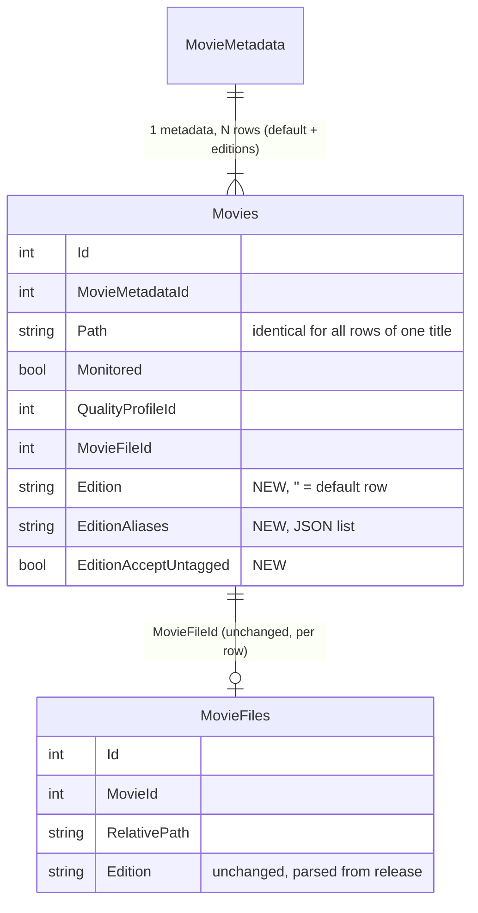

# Multi-edition support for the KrZ-W Radarr fork

Phase 1 design. Fork base: Radarr 6.4.4.10685, branch `personal/all-features-master` (e7d3e2e59). Date 2026-10-24.

## 1. Recommendation

Implement editions as **additional monitored Movie rows that share one MovieMetadata and one folder** ("edition as movie row", architecture B below). Do not build a new MovieEdition entity under MovieFile (architecture A).

Why, in one paragraph: since Radarr v4 a `Movies` row already holds only instance state (path, monitored, quality profile, file id, tags, availability) while all TMDb data lives in `MovieMetadata`. The only thing preventing two instance rows per title is one unique index. If each edition is its own row, every existing per-movie mechanism (wanted lists, cutoff, upgrades, custom-format scoring, history, queue, atomic upgrade, audio verification, retag, notifications, `MoviesSearch`) works per edition with no change. The work shrinks to five contained problems: edition-aware release-to-movie mapping, a shared-folder guard in disk scan and delete, an edition gate in the grab and import decision engines, an add-edition flow in the API/UI, and a naming token. Architecture A would rewrite the same subsystems upstream itself calls "a major front and backend rewrite", and it would collide head-on with the `MovieVersions` table upstream started on 2026-10-22.

## 2. What Radarr already does (verified in the fork)

| Capability | Where | Status |
|---|---|---|
| Parse edition from release title | `src/NzbDrone.Core/Parser/Parser.cs:18` `EditionRegex`; `ParseEdition()` lines 358–369 | Works for Director's/Collector's/Theatrical/Ultimate/Extended/Despecialized, Special/Final/Assembly/… + Cut/Edition/Version, NNth Anniversary, Uncensored/Remastered/Unrated/Uncut/Open Matte/IMAX/Fan Edit/Restored. **Does not match "Ulysses Cut" or "Criterion"** (word list, "Cut" alone never matches). |
| Parse Plex `{edition-X}` tag from a file name | nowhere | Missing |
| Store edition | `MovieFiles.Edition` (migration 117), `ParsedMovieInfo.Edition`, `LocalMovie.Edition`; aggregated download-client title → folder → file in `AggregateEdition.cs:13–25` | Per file, free text. **No edition at Movie level.** |
| Naming | `FileNameBuilder.cs:317–321, 541–548`; `{edition-{Edition Tags}}` collapses when empty (`TitleRegex` line 43, line 616); `{Edition Tags}` forbidden in folder format (`FileNameValidation.cs:12`) | Works, but renders the *release's* spelling |
| Decision engine use of edition | only the custom-format condition `EditionSpecification.cs` | No grab or import rule |
| UI | file edit modal (`FileEditModalContent.js:179`), parse page, naming modal | Nothing in index, wanted, search, manual import |

Where the one-file rule actually lives (the `MovieFiles` table is already N:1 via `MovieId`):

- `Movie.cs:35–38` `MovieFileId`, `HasFile => MovieFileId > 0`.
- `MovieService.cs:439–454` sets `MovieFileId` on file added (last wins), resets to 0 on delete.
- `Housekeepers/CleanupOrphanedMovieFiles.cs:17–22` **deletes every MovieFiles row not referenced by `Movies.MovieFileId`**.
- `ImportApprovedMovie.cs:63–86` groups by `Movie.Id` and rejects a second file ("Movie has already been imported").
- `MovieRepository.cs:252–288` wanted queries on `MovieFileId == 0` / `!= 0`.
- Counts (production code): `MovieFileId` 78 uses in 44 files, `.MovieFile` 86 in 26, `HasFile` 6; frontend `movieFileId` 81, `hasFile` 52, `movieFile` 60.

Uniqueness today: `IX_MovieMetadata_TmdbId` unique and **`IX_Movies_MovieMetadataId` unique** (migration 207 lines 12, 85–86). Code assuming one Movie per TMDb id: `MovieRepository.FindByTmdbId` (FirstOrDefault), `MovieService.MovieExists`, `MovieExistsValidator`, `ParsingService.cs:176`, `ImportListSyncService.cs:146`, `RefreshCollectionService.cs:133`, fork `UserTitleImportService.cs:128`.

Production data (radarr-fr copy of 2026-09-15): 3214 movies, 2676 files, 139 files already carry a parsed edition in 28 spellings (REMASTERED/Remastered, Directors Cut/Director's Cut, iMAX/IMAX…). Naming format is `{Movie Title} ({Release Year}) {Quality Full} {Custom Formats}`: **no edition token**, so today two files in one folder would be merged by Plex as "versions", not editions. Pilots: Fellowship (id 337, file untagged), Waterworld (421, untagged), Star Trek II (428, file already tagged "Theatrical").

## 3. Upstream history and what it means for us

- Canonical request [#1910](https://github.com/Radarr/Radarr/issues/1910) (2017, open, locked). Maintainers: "Everything in radarr is 1:1 and it requires a major front and backend rewrite and database rework" (bakerboy448, 2021-10-26); "we should do it right or not do it at all" (ta264, 2022-01-23). All later issues (#2099, #2203, #2387, #3832, #5791, #7069, #10859, #11755) closed as duplicates. #2099 did ship the custom edition text field in v3.
- Prototype branch [`zeus`](https://github.com/Radarr/Radarr/compare/develop...zeus) (Qstick, 2022): N quality profiles per movie, each keeping its own file in the same folder; migration `213_multi_version.cs`. Abandoned (1546 commits behind).
- **Live draft PR [#11963](https://github.com/Radarr/Radarr/pull/11963)** (2026-10-22): adds a `MovieVersions` table, version = quality profile + path + file, primary mirrors `Movies.*` for legacy code. Team: "Zeus's functionality was what we as a team generally settled on". Note it uses **migration 243**, the number our fork already uses. That rebase clash exists regardless of this feature.
- Upstream's model is quality-keyed, not edition-keyed. Our edition rows are orthogonal to it: if `MovieVersions` lands, each edition row can own N versions. A MovieEdition-under-MovieFile design would conflict with it.

### Can we reuse PR #11963's code? (checked 2026-10-24 via `gh pr view`)

State: open draft on `develop`, author BillyOne971 (outside contributor), opened 2026-10-22, last push 2026-10-23, 47 files, +2094/−40, zero reviews. Done: `MovieVersions` table + migration 243, `MovieVersionService` (302 lines), disk scan per version with "a file already tracked by another version is never imported again", delete/cleanup/media-info resolve the version, `/api/v3/movieversion`, Add Version modal and files-table grouping. **Not done**: manual import and Manage Files per version, interactive and automatic search per version, storing the version with grabs so downloads import into the right version, rename, extras, post-scan events. The team's only steer so far is "very much the Zeus method", and the UI is still being redesigned after reviewer pushback.

Assessment: the parts we would need most are exactly the parts the PR has not written (search, grab routing, import routing, rename), and the parts it has written (file ownership and folder guards for a child entity) are the parts architecture B gets for free because an edition is a Movie row. Adopting it now would mean carrying an unfinished copy of architecture A whose shape upstream is still negotiating, with a migration number that already clashes with ours; when upstream merges a changed version we would conflict with both. What we can take from it: the test fixtures for same-folder scanning (`ScanFixture.cs`, `MediaFileTableCleanupServiceFixture.cs`) as a checklist, and the UI pattern of grouping the Files table instead of adding a section. Recommendation: do not vendor the PR; design B so the edition rule (aliases, accept-untagged, gate specs, `{Edition Name}` token) is a self-contained unit that can later be attached to a `MovieVersion` instead of a `Movie` row if upstream ships versions. Revisit when the PR reaches the search/grab step or merges.
- No fork or tool implements this. Readarr's Book → Edition one-to-many is the closest sibling pattern; irrelevant for B.
- Plex ([Multiple Editions](https://support.plex.tv/articles/multiple-editions/)): requires Plex Pass, new Plex Movie agent, PMS ≥ 1.28.1; tag `{edition-Name}` ≤ 32 chars in file name or folder name ("recommend both"); editions are separate library items with separate watch state, grouped under "Other Editions"; untagged extra files in the folder become "versions" instead. Same-folder, filename-only tagging is stated as supported. **Unverified by us on a live server.**

## 4. Architecture comparison

| Criterion | A. MovieEdition entity, MovieFile → edition | B. Edition as Movie row (recommended) | C. Vendor or wait for upstream PR #11963 (MovieVersions) |
|---|---|---|---|
| Data model | New table; `Movie.MovieFileId` becomes "default edition's file"; `MovieFile.EditionId` | 3 columns on `Movies`; unique index becomes (`MovieMetadataId`, `Edition`) | Upstream table, quality-keyed |
| Pipeline changes | Wanted queries, 8+ decision specs, `ImportApprovedMovie`, `UpgradeMediaFileService` (fork atomic upgrade), housekeepers, history, queue, search criteria, notifications all learn "edition" | None of those change. New: edition mapping in `ParsingService`/`MovieService.FindByTitle`, 1 grab spec, 1 import spec, shared-folder guards | Not available; step 1 only, no timeline |
| Upstream files modified | 40–60, many in DecisionEngine/MediaFiles hot paths | ~10 small marked hunks + new files | 0 |
| Merge burden per upstream release | Days; structural conflicts with #11963 | Hours, same class as atomic-upgrade | n/a |
| API compat | One movie, `movieFile` = default: clean | Extra rows per TMDb id must be hidden from legacy list calls | Unknown |
| UI | New editions panel inside one movie card | Edition rows appear as extra cards unless badged/filtered | Unknown |
| Data-loss risk | Migration rewires file ownership | Migration adds columns only; existing rows become default edition untouched | n/a |
| Build effort (slice 1) | 8–12 weeks | 3–3.5 weeks | 0 |
| Composes with future upstream multi-version | Conflicts | Yes (edition row × versions) | Yes |

Decision: B. Weak points of B and their mitigations are in sections 6, 9, 10 and 15.

## 5. Data model (B)

Rules:

- Default row: `Edition = ''`. Every existing movie is a default row after migration. Exactly one default row per metadata.
- Edition row: `Edition` = canonical display name (≤ 32 chars, Plex limit), `EditionAliases` = normalized match strings, `EditionAcceptUntagged` default false. Same `Path` as the default row; path is read-only on edition rows and propagated from the default row on move/rename.
- Unique index: (`MovieMetadataId`, `Edition`).
- Presets shipped: Theatrical (aliases: theatrical, theatrical cut), Extended (extended, extended cut, extended edition), Director's Cut (director's cut, directors cut, director's edition, dc), Unrated, Final Cut, Ulysses Cut, IMAX, Criterion, Remastered, Special Edition, Ultimate Edition/Cut, Open Matte, Uncut, Anniversary Edition. Free text allowed. Alias normalization: lowercase, strip apostrophes/dots/dashes, collapse spaces.

### Migration 248 (next free; fork owns 243–247)

Up: add the three columns with defaults; drop `IX_Movies_MovieMetadataId`; create unique `IX_Movies_MovieMetadataId_Edition`. No row rewrites, so it is lossless by construction.

Rollback: Radarr's migration runner never executes `Down()`, and an older image on the migrated DB would see duplicate `MovieMetadataId` rows, so the rollback plan is image tag + DB restore from the pre-upgrade backup (standard fork procedure). A scripted "downgrade" that deletes edition rows and their `MovieFiles` rows and restores the unique index will be provided for the arrdev tests, with media untouched either way.

Parser: add Ulysses Cut, Criterion, Despecialized already present, and a `{edition-X}` file-name tag reader to `Parser.cs` (small upstream hunk; also fixes the 10-19 test).

## 6. Edition detection and routing rules

Routing picks which Movie row a release or file belongs to; the decision engine then accepts or rejects.

1. Parse `edition` from the release title (existing) or, for files, from the `{edition-X}` tag, else the aggregated edition (`AggregateEdition`).
2. Find candidate rows for the title (all rows sharing the metadata). In `ParsingService.FindMovie` (`ParsingService.cs:127–210`) and `MovieService.FindByTitle`, replace "first row" with the selector below. Search results carry `searchCriteria.Movie`, so they map to the searched row directly (`ParsingService.cs:212–250`), which is correct: a search for the Extended row must never grab for the Theatrical row.
3. Selector: parsed edition matches an edition row's aliases → that row, even if unmonitored (so it can be rejected there instead of leaking to the default). No match → default row.
4. Default row keeps today's behaviour (accepts any release, tagged or not) **except** releases whose edition matches a sibling edition row: those are rejected for the default row ("sibling exclusion"). This preserves the 139 existing edition-tagged files and all current grabbing for movies without editions.
5. Edition row accepts a release only if the edition matches its aliases, or the release is untagged and `EditionAcceptUntagged` is on.
6. A release whose edition matches no row is accepted by the default row (legacy) unless a per-movie "strict editions" option is on (slice 2). The prompt's "reject unknown edition" is therefore implemented as opt-in strict mode, because the default-reject would regress every movie that has no edition rows.

## 7. Decision rules

| Situation | Grab (RSS/search) | Import (auto/manual) |
|---|---|---|
| Release tagged Extended, movie has Extended row | routed to Extended row; normal profile/cutoff/CF rules of that row | imported into Extended row's slot |
| Release tagged Extended, Extended row unmonitored | rejected on Extended row (existing monitored spec); never falls back to default | rejected unless user picks the row in manual import |
| Release tagged Extended, no Extended row | default row accepts (legacy) unless strict mode | same |
| Untagged release, movie has Theatrical default + Extended row | default row only | default row only |
| Untagged release, Extended row with accept-untagged on | eligible for both rows; each row decides independently, no cross-row comparison | file goes to the row it was grabbed for (history/download id), else selector → default |
| Release tagged Theatrical | default row (Theatrical aliases live on the default row by convention) | same |
| Upgrade | compared only against the same row's file (`UpgradeDiskSpecification`, `UpgradableSpecification`, unchanged) | atomic upgrade parks and replaces only the same row's file (`UpgradeMediaFileService.cs:51`, unchanged) |
| Re-grab loop guard | `HistorySpecification`/`AlreadyImportedSpecification` are already per row; import edition gate uses the download-client title first, so an untagged file inside an "Extended" release still lands correctly | — |
| Manual import | — | explicit movie-row pick = edition override; the edition gate is skipped for user-picked rows |
| Separate torrents per edition (the normal case) | each row grabs its own release; nothing links them | each download is tied to its row by the grab history, so imports never cross rows |
| One torrent containing two cuts (pack) | grabbed by whichever row it matched | the matching file imports into that row; the other file is rejected by the gate and left for manual import, where the selector routes it to the right row (import-into-another-row from one download is slice 2) |
| Manual import of a folder holding both cuts, no movie preselected | — | the selector maps each file to its row by parsed edition or `{edition-X}` tag |

New code: `EditionGateSpecification` (IDownloadDecisionEngineSpecification, permanent rejection with reason text) and `EditionGateImportSpecification` (IImportDecisionEngineSpecification). Both additive files plus DI registration.

Slice 1 note (2026-10-24): Radarr maps one release to exactly one Movie row, so the "untagged release, accept-untagged edition" row above holds for per-row searches (missing / cutoff-unmet / interactive, where the searched row is the candidate) but not for RSS, which routes an untagged release to the default row only. Accept-untagged editions are filled by their own searches; a DownloadDecisionMaker fan-out is deliberately not part of slice 1. Also in slice 1: the grab history binds a download to the row it was grabbed for (tracked-download mapping and the import gate honour it before the edition selector), and the import gate also runs for files already inside the shared folder (section 9's second line of defence).

## 8. Search, RSS, wanted

- `MoviesSearch {movieIds}`, `MissingMoviesSearch`, `CutoffUnmetMoviesSearch` and interactive search already operate per Movie row: per-edition search is free. Search titles come from the shared metadata (and the fork's regional/user titles), so an Extended search issues the same queries and the gate keeps only Extended results.
- `/wanted/missing` and `/wanted/cutoff` return edition rows **by default** (each resource carries `edition`), so missing editions are searchable and visible; the frontend shows the badge.
- RSS: routing (section 6) sends tagged releases to the matching row.
- Interactive search: show an Edition column (release already has `edition`), rejection reason "Edition 'Extended' belongs to another edition of this movie".

## 9. Import and rename

- Shared folder: `DiskScanService.cs:137–143` treats sibling files as unmapped. Fix `MediaFileService.FilterExistingFiles` to also exclude files owned by sibling rows (one query); the import gate is the second line of defence. `MediaFileTableCleanupService` and `CleanMediaFiles` are per row and stay as they are.
- Extras: `ExistingSubtitleImporter.cs:77`, `ExistingOtherExtraImporter.cs:58`, `ExistingMetadataImporter.cs:70` attach every extra in the folder to `movie.MovieFileId`. With two rows, both would claim all subtitles and rename them back and forth. Slice 1 adds a stem match (extra belongs to the file whose name it starts with) in those importers for movies that have siblings.
- Naming: new token `{Edition Name}` = the row's canonical edition (empty for the default row). Recommended format on both instances: `{Movie Title} ({Release Year}) {edition-{Edition Name}} {Quality Full} {Custom Formats}`. Because it is empty for default rows, adopting it renames nothing in the existing library. Do not use `{Edition Tags}` for this: it would start tagging the 139 release-parsed spellings. Folder format unchanged (Plex accepts file-name-only tags).
- Metadata files (.nfo/images) written per row into the same folder: identical content, harmless; Plex ignores them.

## 10. Delete, recycle, move

- `MediaFileDeletionService.cs:91–125` already refuses to delete a folder whose path equals another movie's (logs an error). Change for sibling rows: delete only that row's `MovieFiles` through the recycle bin, skip the folder, no error.
- Deleting the default row while edition rows exist is refused by the API (delete editions first, or a "demote/promote default" action in slice 2).
- Path change on the default row (edit, bulk move, root-folder move, folder rename on refresh) propagates to sibling rows and moves the folder once (`MovieService.UpdateMovie` / `MoveMovieService`). Path edits on edition rows are rejected by validation. `MoviePathValidation.cs:33` allows equal paths among rows of the same metadata.
- `CleanupOrphanedMovieMetadata` joins all Movies rows, so metadata survives while any row exists. Import-list exclusion on delete only from the default row.

## 11. API and UI

Backward compatibility rule: **any call that does not opt in sees exactly what it sees today.**

| Endpoint | Change |
|---|---|
| `GET /api/v3/movie`, `?tmdbId=` | Edition rows excluded unless `includeEditions=true`. Default rows gain `editions: [{id, name, monitored, hasFile, qualityProfileId, movieFileId}]`. |
| `GET /api/v3/movie/{id}` | Works for any row; edition rows carry `edition: {name, aliases, acceptUntagged}` and `editionParentId`. |
| `POST /api/v3/movie` | New optional `edition` object: creates an edition row for an existing title (same path, `MovieExistsValidator` becomes per (tmdbId, edition)). Import lists and collections keep using `MovieExists(tmdbId)` so they never create editions. |
| `PUT /api/v3/movie/{id}` | Edition fields editable; path rejected on edition rows. |
| `DELETE /api/v3/movie/{id}` | Per row; `deleteFiles` deletes only that row's files. |
| `/api/v3/wanted/*` | Include edition rows by default. |
| `/api/v3/calendar` | Edition rows excluded unless `includeEditions=true`. |
| `/api/v3/command` MoviesSearch etc. | Unchanged. |
| `/api/v3/release?movieId=`, `/manualimport` | Unchanged shape (the reprocess `POST /manualimport` items gain an optional `editionOverride`, true once the user picked the movie row); manual-import movie picker lists edition rows with a badge. |
| `/api/v3/moviefile?movieId=` | Unchanged. |
| Webhook / Plex Connect payloads | `movie.edition` string added; `movieFile.edition` already present; Plex partial scan of the folder unchanged. |

UI slice 1: edition badge appended to the title wherever a movie title is rendered (index, details, queue, history, manual import, wanted); details page gets an "Editions" box listing sibling rows with monitor toggle, file status and links, plus "Add edition" modal (preset picker, aliases, profile, monitored, accept-untagged). Frontend requests pass `includeEditions=true`. Slice 2: index filter "hide editions", interactive-search edition column, manual-import edition override column, strict-editions option, promote-default action.

## 12. Notifications

Per-row events already carry the row's `Movie` and `MovieFile`. Add `edition` to webhook `movie` objects and to the Discord/Telegram title template (`{Movie Title} [{Edition}]`). Plex Connect: the partial folder scan picks up both files; Plex splits them by the tag.

## 13. Ecosystem impact (scripts not on this box; behaviour as described in the task, UNVERIFIED)

| Tool | Under the compat rule | Needs |
|---|---|---|
| dedup_brain.py (EN vs FR by TMDb id) | Sees default rows only: unchanged and safe by construction. Edition files are invisible to it, so no bilingual dedup of editions. | Code change later: key on (tmdbId, edition) via `includeEditions=true`; never compare across editions. |
| orphan-curator | **Breaks**: edition files on disk belong to hidden rows and would look orphaned. | Must add `includeEditions=true` (or use `/moviefile`) before editions are created on prod. Gate the rollout on this. |
| incomplete-reconciler | Default rows unchanged; edition rows invisible. | `includeEditions=true` to cover editions. |
| Missing/upgrade hunters (`/wanted`, `MoviesSearch`) | `/wanted` returns edition rows, `MoviesSearch` by id works per row: editions get hunted for free. If a hunter dedupes by tmdbId it drops one edition. | Review dedupe keys. |
| seed-lock-sync / xseed ledger / seed-import-relink | Per file path; new file names carry the tag. Breaks only if they assume one video per folder. | Review folder assumptions. |
| codec-retag, Tdarr flows | Per file: unaffected. Tdarr flows that pick "the" file in a folder or rename must be checked. | Review. |
| cleanuparr | Queue based: unaffected. | None. |
| Plex audit scripts | Plex editions are separate items with the same TMDb id; a tmdbId-keyed audit sees duplicates or mismatches. | Key on (tmdbId, edition tag). |
| Second instance (radarr-en) | Same feature; edition policy per instance (which instance holds which cut) is a separate decision. | Decide before rollout. |

## 14. Slices

Slice 1 (proves the model on the pilots): migration + entity + presets; routing; two gate specs; shared-folder and extras guards; delete/move rules; API (`includeEditions`, `edition`, add-edition via POST); `{Edition Name}` token; parser additions (Ulysses Cut, Criterion, `{edition-X}` reader); edition badge + editions box + add modal in UI; tests; docs/features/multi-edition.md.

Slice 2: interactive-search column, manual-import override column, calendar/index filters, strict mode, promote-default, notification templates, script updates in the ecosystem.

## 15. Effort and merge burden

| Item | Estimate |
|---|---|
| Backend slice 1 (incl. unit tests) | 12–14 dev-days |
| Frontend slice 1 | 3–4 dev-days |
| Integration on arrdev with DB copies + 3 pilots | 3 dev-days |
| Slice 2 | 7–10 dev-days |
| Upstream files touched (slice 1) | ~10: `Parser.cs`, `ParsingService.cs`, `MovieService.cs`, `MovieRepository.cs`, `MediaFileService.cs`, `MediaFileDeletionService.cs`, `MoviePathValidation.cs`, `MovieExistsValidator.cs`, `FileNameBuilder.cs`, `MovieController.cs`/`MovieResource.cs`, `CalendarController.cs`, three extras importers; all as marked `krzw(multi-edition)` hunks |
| Merge burden | Comparable to atomic-upgrade-imports: hours per upstream release. The last three rebases of the whole fork needed small fix-ups (7 lines for 6.4.4). Measured once in Phase 2 by rebasing the branch onto the next upstream tag. |

## 16. Risks

1. Upstream `MovieVersions` (#11963) lands and changes `Movies`/`MovieFiles` shape. B composes with it, but the migration-number clash (upstream 243 vs fork 243) will bite the whole fork at that rebase. Separate decision: move fork migrations to a high band before then (existing prod DBs have 243–247 applied, so renumbering needs a one-off VersionInfo fix-up).
2. Shared folder edge cases not listed here (Kodi metadata, trailers/extras from other tools, `DeleteEmptyFolders`). Mitigated by the sibling filter and arrdev testing on copies of the real folders.
3. External tools keyed on TMDb id (orphan-curator first). Mitigated by hiding edition rows by default and gating prod rollout on the orphan-curator change.
4. Plex same-folder filename-only tagging is documented but not tested by us. Verify on a scratch Plex library before prod; fall back to tagging the folder for one edition is not possible with a shared folder, so if Plex misbehaves the design would need per-edition subfolders (supported by B by giving edition rows their own Path, at the cost of the propagation rule).
5. UI noise: edition rows appear as extra cards in the index. Badge in slice 1, filter in slice 2.
6. Legacy default-row behaviour means an "Extended" release can still land on a movie with no editions defined, exactly as today. Strict mode is opt-in.

## 17. Pilot plan (arrdev, Phase 2)

| Movie | Default row | Edition row | Expected |
|---|---|---|---|
| Waterworld (421) | Theatrical, existing file | Ulysses Cut (aliases: ulysses cut) | parser matches "Ulysses Cut"; untagged releases never reach the edition row; interactive search on the edition row rejects untagged with a clear reason |
| LOTR Fellowship (337) | Theatrical, existing file | Extended (extended, extended edition, extended cut) | Extended releases routed and imported to `{edition-Extended}`; default file untouched; both files survive rescan, housekeeping, rename, and delete of one row |
| Star Trek II (428) | existing file tagged "Theatrical" | Director's Cut (director's cut, directors cut, director's edition) | "Director's Edition" alias routes; `{Edition Name}` empty on default keeps current file name |

Acceptance: wanted lists show the edition rows; `MoviesSearch` per row; `GET /movie` without the flag returns 3214 rows as before; orphan-check script run with `includeEditions=true` reports no false orphans.

## 18. Open decisions for sign-off

1. Architecture B as above.
2. Edition rows hidden from legacy list calls, visible in `/wanted`.
3. Default row keeps legacy "any edition" acceptance with sibling exclusion; strict mode opt-in.
4. Naming format change to `{edition-{Edition Name}}` on both instances (zero renames of existing files).
5. Which instance (EN/FR) holds which editions, and the orphan-curator update as a rollout gate.
6. Do not vendor PR #11963 now; keep the edition rule portable to a future `MovieVersion` and revisit when the PR reaches search/grab or merges.

## Sources

Fork code at the commit above (file:line as cited). Upstream: issues #1910, #2099, #2203, #2387, #3832, #5791, #7069, #10859, #11755; PR #11963; branch `zeus` commit 5ad3f96; Servarr wiki radarr/settings (Edition Tags) and faq; Plex support articles "Multiple Editions", "Naming and organizing your movie media files", "Multi-Version Movies". Production figures from the radarr-fr DB copy of 2026-09-15.
